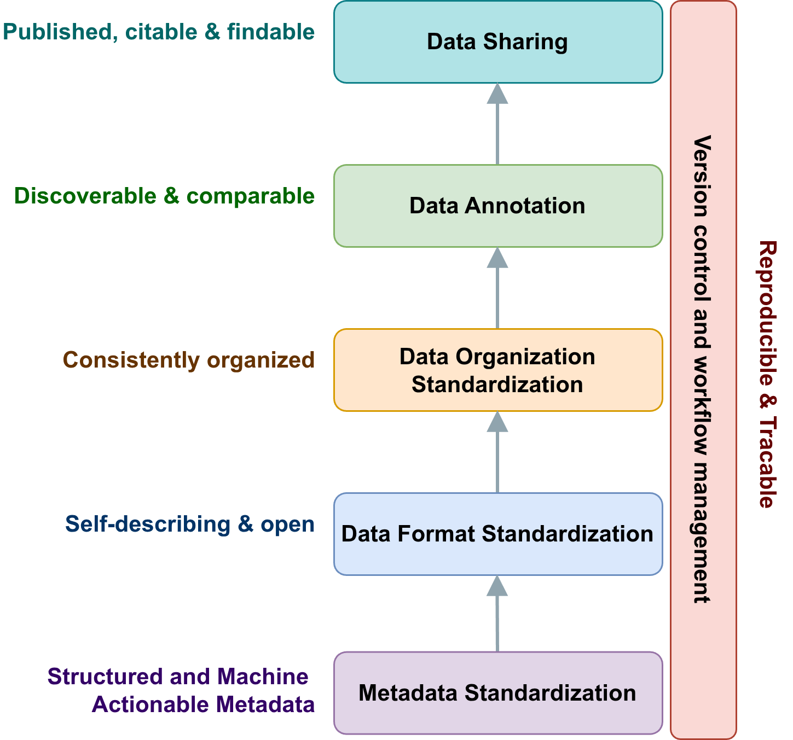

# fairephys: a practical workflow for FAIR sharing of electrophysiology data

**Status: pre-alpha.** fairephys is used to curate the NHP-EBRAINS datasets and has not been tested elsewhere yet; its API will change between 0.x versions.

## Why fairephys

Electrophysiology recordings can answer more questions than the ones they were recorded for. Shared with enough context, a single lab's dataset can serve neural decoding, spike sorting benchmarks or computational models in groups that had no part in the experiment. What makes recordings reusable is the documentation, organization and description that travel with them. The FAIR principles (findable, accessible, interoperable, reusable) describe what such data should offer.

For extracellular electrophysiology, that context is hard to assemble. Acquisition systems (Blackrock, Tucker-Davis Technologies, Plexon, SpikeGLX, Intan and others) each store recordings in their own format, many of them proprietary. The gains needed to recover physical units, the mapping of channels to electrode contacts and the probe geometry often live outside the recording: in vendor software, in a spreadsheet, in a lab notebook or in the experimenter's memory. A recording that arrives without its species, probe, brain region and session parameters can hardly be interpreted, however good its signal.

### What reusable data requires

A dataset that others can find, understand and reuse has to meet several requirements. The figure shows them in the order fairephys works through them: each step draws on what the steps before it produced, and version control accompanies all of them.

<p align="center"></p>

1. **Metadata standardization: structured and machine-actionable metadata.** What was recorded, from whom, with which equipment and under which conditions is captured in a structured form that people can review and software can read. The later steps draw on it.
2. **Data format standardization: self-describing and open files.** The recordings can be read without the vendor's software and carry their own context: what was measured, at what rate, on which channels, with what gain and filtering. fairephys writes NWB files for this.
3. **Data organization standardization: a consistent organization.** Folders, file names and the tables beside the data follow a standard, so that people and analysis tools find their way through any dataset that follows it. fairephys uses BIDS with its draft extension for microelectrode electrophysiology (BEP032).
4. **Data annotation: discoverable and comparable datasets.** Species, brain regions and techniques are named with controlled terms from shared ontologies, so that a search finds the concept and not only a spelling, and datasets from different labs can be compared by the same terms. fairephys uses openMINDS, the metadata framework of the EBRAINS Knowledge Graph.
5. **Data sharing: published, citable and findable.** The dataset is hosted on an accessible repository with a persistent identifier (a DOI), so that it can be cited and found.

Throughout, version control and workflow management keep the path from the raw recording to the published dataset reproducible and traceable.

The community has built mature standards and tools for each of these requirements. They developed largely independently, though, and they represent the same information in different ways. The age of a subject, for example, is a number of years in BIDS, an ISO 8601 duration in NWB and a value with a unit in openMINDS; a species is free text in NWB and a controlled term in openMINDS. Entering the same metadata separately for each standard is laborious, does not scale and lets the outputs drift apart.

fairephys connects these standards and tools into one reproducible workflow. It captures the metadata as one canonical record and derives the NWB files, the BIDS organization and the openMINDS annotations from it; for sharing, it writes the DataCite record, and the curated dataset is versioned and published with tools such as DataLad and GIN. fairephys was developed within the In2PrimateBrains consortium, whose laboratories record with many different systems and had no shared metadata conventions, to bring their recordings into one consistent, shareable form. Its aim is that researchers can share their data in a FAIR way without resolving the incompatibilities between the standards by hand.

## How it works

```
YAML templates (the lab's description)        raw recordings
              |                                     |
              +------------> one odML record <------+   (Neo reads channels, rates, durations)
                                   |
            +----------+-----------+-----------+------------------+
            |          |           |           |                  |
           NWB    BIDS layout   openMINDS   DataCite,       sanity checks
                   (BEP032)                  README     across all of them
```

1. **Capture the metadata.** The researcher or curator describes the experiment in YAML templates, one per concern: the dataset, the subject, the hardware, the behavioural protocol, the recording sessions, the electrode placements and the processing. What stays the same across sessions is written once; each session entry holds only what differs. JSON schemas check every template before it is used, so a missing required field or a value of the wrong type is caught at entry, not in a finished output.
2. **Build one canonical record.** The compiler merges the templates into a single odML document and adds what the recordings already say about themselves (channel names, sampling rates, durations, read with Neo), so that this information is not typed by hand. Plain-text terms such as species and brain regions are resolved to controlled terms (openMINDS, UBERON). Every value keeps its origin: the sources named in the template it was written in, or the file header it was read from.
3. **Translate it for each standard.** Declarative registries, written in YAML, state how the properties of the record appear in NWB, BIDS and openMINDS, including the change of unit, type, structure or vocabulary each standard needs; only the electrode structures of the NWB file are assembled in code, from the probes and their placements. From the record, fairephys converts the recordings to NWB (NeuroConv, with the probe geometry from ProbeInterface), writes the BIDS layout with its tables and sidecars, builds the openMINDS metadata for the EBRAINS Knowledge Graph (fairgraph) and adds a DataCite record and a dataset README.
4. **Check across all outputs.** fairephys compares the outputs with the raw data and with each other: raw samples against the NWB, the probe geometry of ProbeInterface against the BIDS electrodes table and the NWB electrode table, channel counts and names across BIDS and NWB. The BIDS validator, the NWB Inspector and fairgraph then check each output against its own standard.

**Version control with DataLad.** In the recommended layout, each dataset is a DataLad dataset with two nested datasets (subdatasets): `raw-data`, the lab's own repository of the original recordings, which the curation reads and never changes; and `curated-data`, the outputs, a repository of its own that is published separately, for example on GIN, whose DOI service reads the DataCite record fairephys writes. The templates and `curate.py` sit in the dataset folder around them. This keeps the raw data with the lab that owns them, lets the curated outputs be reviewed, versioned and cited on their own, and stores large binary files such as NWB in git-annex rather than in git. Because the dataset folder records which version of the raw data and which version of the outputs belong together, each release of the outputs can be traced back to the recordings and templates it was made from. fairephys does not require DataLad, but its writers are made for this layout.

A dataset adds one script, `curate.py`, for what only that dataset knows: where its files are, how its channels map to probe contacts, how its session ids read. Everything else is shared across datasets.

How each of these steps works in the code (the modules behind it, the templates and registries, the probes and placements, the outputs and the checks, and what a dataset's `curate.py` contains) is described in [docs/pipeline.md](docs/pipeline.md).

## Principles

**One canonical record between the lab and the standards.** Every output is derived from the same odML record instead of being written separately for its standard. A value corrected once in the templates therefore reaches every output when the pipeline runs again, and all outputs can be checked against one reference. The templates are designed to cover what the target standards require together, so that each output can be filled from the one record.

**The templates describe the experiment as a whole.** They are organized by what an experiment consists of, not by what any one standard asks for: the dataset, the subject, the hardware, the protocol, the sessions and the electrode placements. Their fields carry the names a neuroscientist would use, such as contact pitch, brain region or session id. What stays the same throughout the experiment is written once, and what changes from session to session is written per session. A researcher can therefore review the description of their own experiment without learning NWB or BIDS, and another lab with similar equipment can start from a filled template instead of from scratch. Because the templates describe the experiment rather than a format, a new output format needs a new reader of the record, and new template fields only where it asks for information the record does not hold yet.

**Translations are data, not code.** Each mapping from the record to a standard is, wherever possible, a registry entry that a reviewer can read in one place, that applies unchanged to every dataset once it is verified, and that can be updated when a standard changes without touching the pipeline code. A new BIDS column or openMINDS field is usually a new entry. The entries also name the kind of difference between the standards they resolve: unit, type, vocabulary, structure, cardinality or coverage.

**Consistency is checked across standards.** Producing several outputs from one record opens a kind of error that no single validator sees: a mapping or conversion error can make two outputs disagree while each passes its own validator, for example an electrode at one position in the BIDS table and at another in the NWB file. fairephys therefore runs checks that read the raw data and all representations at once, next to the validators of each standard. An error in the record itself, such as a swapped hemisphere, reaches every output consistently; the schemas catch what they can at entry, and the rest is caught by the lab's review of its own description.

**Every value has an origin.** The metadata of one dataset come from many places: the lab's documents and correspondence, the headers of the recording files, ontology lookups, and values the pipeline derives, such as the probe geometry. Each template names its sources, a comment next to a value names that value's own source, and the compiled record marks every property with the sources of its template or with its machine origin. A reader can thus tell what the lab stated, what was read from a file and what was computed, and a doubtful value can be traced back and checked. The same care applies to what is not known: a value nobody knows stays empty with the reason next to it, and the pipeline fills in no value of its own. Where a standard requires a field that is not known, the output carries that standard's marker for a missing value ("n/a" in BIDS, "unknown" for the location of an NWB electrode group) and the pipeline reports it; a term that does not resolve to a controlled term is reported to the curator rather than guessed.

**Build on the community's tools.** Reading proprietary formats (Neo), writing NWB (NeuroConv, PyNWB), describing probes (ProbeInterface), validating (BIDS validator, NWB Inspector) and talking to the Knowledge Graph (fairgraph) are left to the libraries made for them. fairephys adds the metadata record, the translations and the cross-standard checks that let them work from one description.

**A curated dataset can always be rebuilt.** A curated dataset is the product of its inputs: the raw recordings, the filled templates and the code (the shared pipeline at a stated version and the dataset's `curate.py`); the openMINDS metadata also take into account what the Knowledge Graph already holds. Every output, from the NWB files to the README, is generated from these, and none is edited by hand. A correction is therefore made where the information lives, in a template or in the script, and every output takes it up on the next run. This keeps the curation reproducible and traceable: anyone with the inputs can regenerate the dataset, every change is visible in the version history of the templates and the code, and the raw recordings are only read, never changed.

## Scope

fairephys covers extracellular electrophysiology, both acute recordings with probes placed anew in each session and chronic recordings from implanted arrays. It converts the raw broadband recordings of Blackrock, SpikeGLX, TDT (tanks and SEV files) and Plexon (.pl2) systems; for other formats, the dataset's `curate.py` writes the NWB with the shared helpers of `fairephys.converters`. Beside the recording, the NWB can hold trials, time intervals, sorted units and behavioural series, and auxiliary signals (eye tracking, EMG, motion) become BIDS files of their own.

## Installation

```bash
pip install fairephys              # once released; until then from a clone:
uv sync                            # in the repository
pip install "fairephys[plexon]"    # Plexon .pl2 files (needs Wine)
```

Python 3.11 or newer.

## Quick start

```bash
fairephys init my-dataset --format blackrock   # templates and curate.py
# fill in my-dataset/metadata/curated/*.yaml, then:
uv run python my-dataset/curate.py --all       # compile, probes, BIDS, short test NWB files, checks
uv run python my-dataset/curate.py --full --convert --session <session id>
```

NWB files are short test files (stubs) by default, so the whole pipeline reruns in seconds while the metadata change; `--full` converts the complete recordings once everything is final.

## Documentation

- [docs/pipeline.md](docs/pipeline.md): the steps, templates, registries, formats, probes and placements, outputs and checks
- [src/fairephys/_resources/templates/README.md](src/fairephys/_resources/templates/README.md): the metadata templates
- [src/fairephys/_resources/registry/README.md](src/fairephys/_resources/registry/README.md): the mapping registries
- [src/fairephys/probes/README.md](src/fairephys/probes/README.md): probe geometry from the metadata

## Development

```bash
uv sync
uv run pytest
```

## License

MIT, see [LICENSE](LICENSE). Third-party files shipped with the package (the BIDS schema, the Creative Commons licence texts) are listed in [NOTICE.md](NOTICE.md).

## Citation

See [CITATION.cff](CITATION.cff).

## AI assistance

The implementation of the code was assisted by Claude Code (Anthropic), which helped write, test and review it and draft its documentation. The conception and design of the workflow are the author's.

## Acknowledgements

fairephys was developed within:

- NHP-EBRAINS, a project of the EBRAINS 2.0 Open Call, which has received funding from the European Union's Horizon Europe Programme under grant agreement No. 101147319 (EBRAINS 2.0);
- the In2PrimateBrains consortium, which has received funding from the European Union's Horizon 2020 research and innovation programme under the Marie Skłodowska-Curie grant agreement No. 956669.
